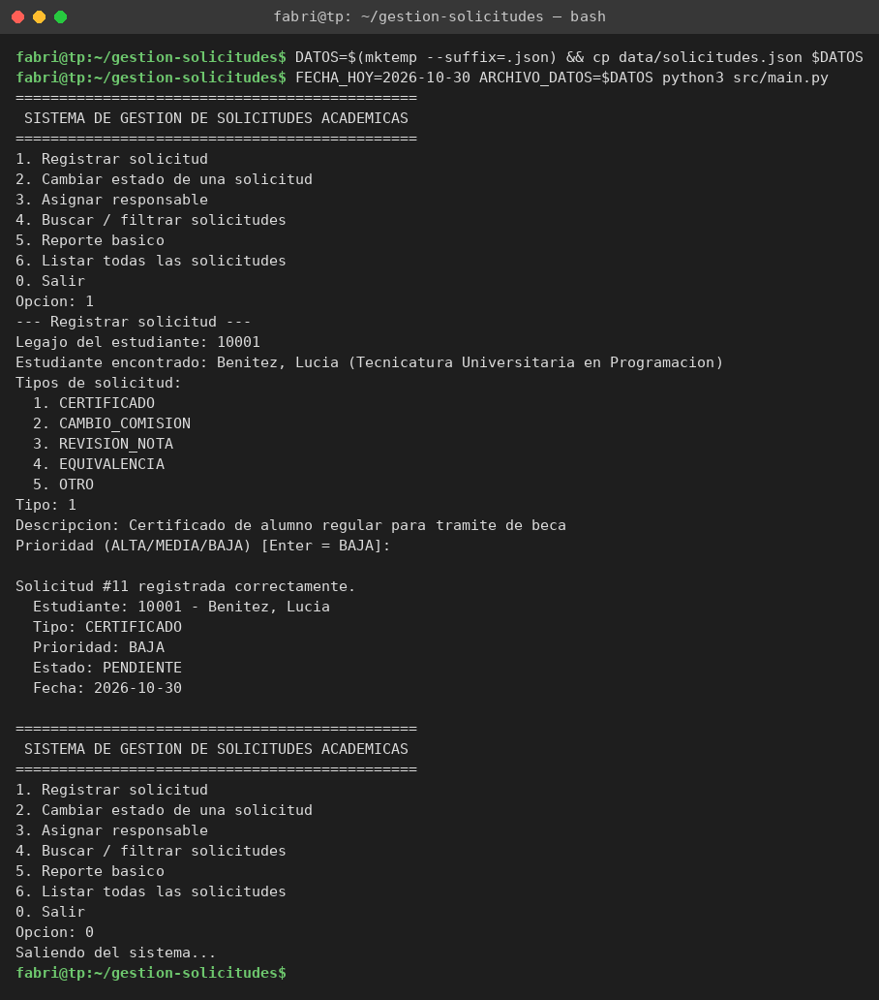
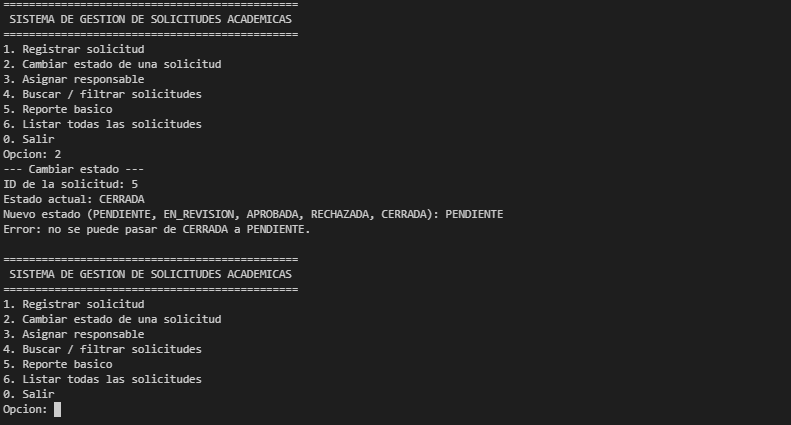
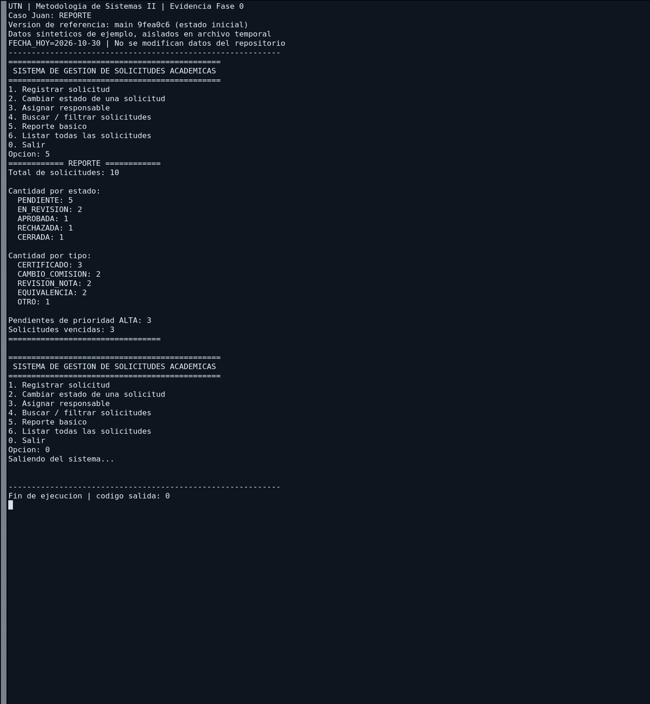

# Calidad externa vs. calidad interna (versión estado-inicial)

## 1. Calidad externa: lo que ve el usuario

Desde el punto de vista del usuario, el sistema funciona correctamente: las 6 operaciones
responden como se espera, los errores de carga se informan y los datos se conservan entre
ejecuciones.

| Funcionalidad | Resultado observado | Evidencia |
| --- | --- | --- |
| Registrar solicitud | Se crea en estado PENDIENTE; rechaza datos faltantes | antes_fabri_registrar-valida.png, antes_fabri_registrar-datos-faltantes.png |
| Cambiar estado | Acepta transiciones válidas y rechaza las inválidas | antes_gabriel_cambio-estado-valido.png, antes_gabriel_cambio-estado-invalido.png |
| Asignar responsable | Asigna responsables existentes y rechaza inexistentes | antes_fabri_asignar-responsable-valido.png, antes_fabri_asignar-responsable-inexistente.png |
| Buscar / filtrar | Filtra por estado, tipo, prioridad y legajo; informa si no hay resultados | antes_juan_filtro-*.png |
| Reporte básico | Muestra totales por estado, por tipo y pendientes de prioridad alta | antes_juan_reporte.png |
| Listar solicitudes | Muestra todas las solicitudes cargadas | antes_fabri_listar-todas.png |
| Persistencia | Los datos siguen al cerrar y volver a abrir el programa | antes_fabri_persistencia-reinicio.png |

*Figura 1. Registro de una solicitud con datos válidos: el sistema la crea en estado PENDIENTE y confirma la operación.*

*Figura 2. Intento de cambiar una solicitud de CERRADA a PENDIENTE: el sistema rechaza la transición e informa el error al usuario.*

*Figura 3. Reporte básico: el sistema muestra la cantidad de solicitudes por estado, por tipo y las pendientes de prioridad alta.*

## 2. Calidad interna: lo que ve el programador

Aunque el sistema funciona, su estructura interna dificulta entenderlo, modificarlo y probarlo.

| Aspecto | Problema | Smells relacionados |
| --- | --- | --- |
| Legibilidad | Métodos muy largos (`registrar()` tiene 81 líneas y `procesar_opcion()` 94), nombres que no dicen qué contienen (`lst`, `aux`, `c1`–`c5`) y comentarios que no coinciden con el código; hay que leer todo para entender una parte | S01, S03, S12 |
| Mantenibilidad | Estados, tipos y prioridades escritos como texto repetido en muchos lugares; la lógica de filtrado está copiada cuatro veces; un método recibe 9 parámetros. Cualquier cambio obliga a buscar y modificar varios lugares a mano | S02, S04, S05, S06, S07 |
| Acoplamiento | Una sola clase hace todo (menú, lógica, archivo y reporte) y depende directamente de `ArchivoJSON`; tocar una parte puede romper otra | S10 |
| Cohesión | Los cálculos de antigüedad y vencimiento usan datos de la solicitud pero están en el gestor, y la clase `Solicitud` casi no tiene comportamiento propio | S08, S09 |
| Testeabilidad | La lógica está mezclada con la lectura de la consola y con el archivo; no se puede probar una regla de negocio (por ejemplo, una transición de estado) sin pasar por el menú | S01, S10 |
| Manejo de errores | Errores que se ignoran (`except: pass`) o se devuelven como códigos numéricos (-1, -2, -3) que hay que interpretar en otro lado | S11 |

## 3. Ejemplo concreto del costo de cambio

**Cambio a evaluar:** agregar un nuevo estado, `EN_ESPERA_DOCUMENTACION` (la solicitud queda frenada hasta que el estudiante presente documentación).

En la versión inicial habría que modificar:

| Nº | Archivo y lugar | Qué hay que cambiar |
| --- | --- | --- |
| 1 | gestor_solicitudes.py, procesar_opcion(), l. 63 | Agregar el estado al texto que lista los estados posibles al cambiar estado |
| 2 | gestor_solicitudes.py, procesar_opcion(), l. 108 | Agregar el estado al texto que lista los estados posibles al filtrar |
| 3 | gestor_solicitudes.py, cambiar_estado(), l. 267 | Agregar el estado a la condición que valida si el estado ingresado es válido |
| 4 | gestor_solicitudes.py, cambiar_estado(), l. 272–286 | Agregar una rama al if/elif de transiciones con sus reglas, y revisar las ramas existentes para decidir desde qué estados se puede llegar a él |
| 5 | gestor_solicitudes.py, reporte(), l. 367 | Declarar un contador nuevo (c6) |
| 6 | gestor_solicitudes.py, reporte(), l. 374–383 | Agregar una rama al if/elif que cuenta solicitudes por estado |
| 7 | gestor_solicitudes.py, reporte(), l. 401–406 | Agregar la línea que imprime la cantidad del nuevo estado |
| 8 | gestor_solicitudes.py, esta_vencida(), l. 427 | Decidir si una solicitud en este estado puede vencer y agregarlo a la condición |
| 9 | gestor_solicitudes.py, proc(), l. 493–497 | Agregar la conversión de las variantes en minúscula ("en espera documentacion", etc.) al cargar el archivo |

**Total: 9 lugares en 5 métodos distintos de la misma clase.** El estado se escribe como texto suelto en todos ellos, así que un error de tipeo en cualquiera no lo detecta el sistema: la solicitud simplemente no se contaría en el reporte o no pasaría la validación.

Además hay un riesgo oculto: en reporte(), l. 394, las pendientes se detectan con `x.estado[0:4] == "PEND"`. Si el nuevo estado empezara con "PEND" (por ejemplo, `PENDIENTE_DOCUMENTACION`), se contaría como pendiente sin que nadie lo note.

**Después del refactoring** (se completa en la Fase 4): agregar un estado debería requerir modificar 2 lugares: el enum `Estado` y la definición de sus transiciones permitidas.

### Costo de cambio DESPUÉS del refactoring

Después de aplicar los refactorings de Fase 3, agregar el mismo estado `EN_ESPERA_DOCUMENTACION` 
requiere modificar:

| # | Archivo y lugar | Qué cambiar |
|----|---|---|
| 1 | `src/modelos/estado.py`, enum `Estado` | Agregar `EN_ESPERA_DOCUMENTACION = "EN_ESPERA_DOCUMENTACION"` |
| 2 | `src/modelos/estado.py`, método `puede_pasar_a()` | Agregar reglas de transición en la tabla de transiciones |

**Total: 2 lugares en 1 archivo.**

### Mejora obtenida

| Métrica | Antes | Después | Mejora |
|---------|-------|---------|--------|
| Lugares a modificar | 9 | 2 | ↓ 78% |
| Métodos afectados | 5 | 1 | ↓ 80% |
| Riesgo de error de tipeo | Alto | Bajo | ✅ |
| Riesgo de inconsistencia | Alto | Nulo | ✅ |
| Necesidad de leer lógica dispersa | Sí | No | ✅ |

### Por qué mejora

- **Enum centralizado:** El estado es un tipo, no un string suelto
- **Tabla de transiciones centralizada:** Un único lugar donde definir las reglas
- **No hay if/elif dispersos:** La lógica de validación está en un método, no repetida
- **Sin conversiones manuales:** No hay normalizaciones variantes de mayúsculas
- **Mejor testeabilidad:** Se puede crear un `Estado` en un test sin pasar por la consola

### Cambios clave que causaron esta mejora

| Refactoring | Impacto |
|---|---|
| Replace Conditional with Polymorphism (Gabriel, S04) | Estados centralizados en Enum con tabla de transiciones |
| Replace Magic String with Enum (Gabriel, S05-S06) | Tipos y prioridades ya no son strings sueltos |
| Extract Class SolicitudService (Gastón) | Lógica separada de UI; más fácil de aislar cambios |

## 5. Análisis estático (Fase 4)

| Métrica | Antes (estado-inicial) | Después (Fase 3) | Mejora |
|---------|---|---|---|
| Líneas de código (gestor) | 379 | 306 | ↓ 19% |
| Líneas de código (servicio) | — | 130 | ✅ Nueva clase |
| Total líneas | 379 | 436 | +15% (pero separado) |
| Métodos (gestor) | 16 | 21 | +5 (más pequeños) |
| Métodos (servicio) | — | 14 | ✅ Lógica pura |
| Métodos >20 líneas (gestor) | 4 | 5 | Mejor distribuidos |
| Variables crípticas | 8 (lst, ests, resp, aux, x) | 0 | ✅ 100% claras |
| Duplicación de filtros | 4 métodos idénticos | 1 método `_filtrar()` | ↓ 75% |
| Parámetros máximos en método | 9 (`registrar_solicitud`) | 2 | ↓ 78% |

**Conclusión:** Aunque el código total es ligeramente más largo (+15%), está mejor distribuido entre dos clases con responsabilidades claras. El gestor pasó de 379 a 306 líneas (↓19%), y la lógica se movió a una clase testeable sin I/O. Los métodos pequeños son más fáciles de entender y mantener que pocos métodos grandes.

## 4. Conclusión

La calidad externa es buena: el usuario no percibe problemas. La calidad interna es baja:
el costo de cambiar el sistema es alto y cada modificación tiene riesgo de romper algo
que hoy funciona. Por eso el trabajo se enfoca en mejorar la estructura sin cambiar el
comportamiento externo.