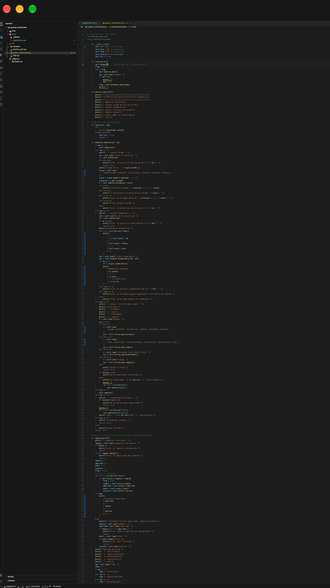
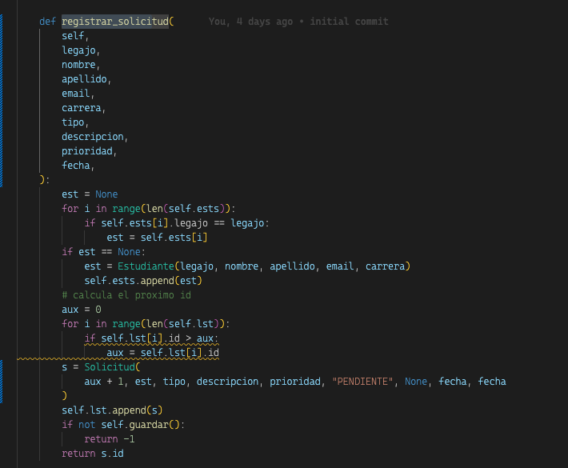
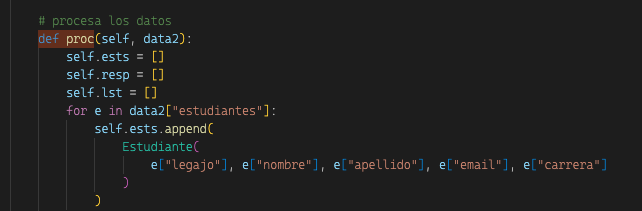
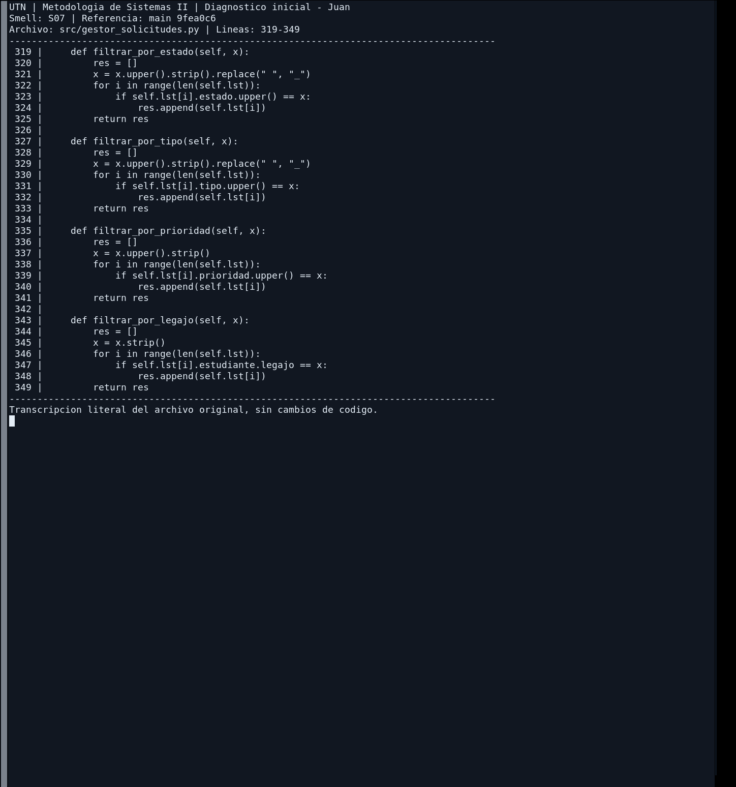

| ID | Smell | Evidencia | Ubicación | Impacto | Riesgo de mantenimiento | Prioridad | Principio violado | Refactoring propuesto | Autor |
| --- | --- | --- | --- | --- | --- | --- | --- | --- | --- |
| S01 | Long Method | `procesarOpcion()` tiene 80 líneas y mezcla lectura de datos, validación, guardado e impresión. Ver `codigo_gaston_S01.png` | `GestorSolicitudes.java` → `procesarOpcion()`, l. 40–120 | Difícil de leer y de entender; no se puede testear cada parte por separado | Cambiar una parte (por ejemplo, la validación) puede romper otra (el guardado o la impresión) | Alta | SRP; Clean Code: funciones cortas que hacen una sola cosa | Extract Method | Gaston |
| S02 | Long Parameter List | `registrarSolicitud(legajo, nombre, apellido, email, carrera, tipo, descripcion, prioridad, fecha)` recibe 9 parámetros. Ver `codigo_gaston_S02.png` | `GestorSolicitudes.java` → `registrarSolicitud(...)`, l. 130 | Fácil equivocarse en el orden de los parámetros; las llamadas son largas y poco claras | Agregar un dato nuevo obliga a cambiar la firma y todas las llamadas al método | Media | Clean Code: pocos parámetros por función | Introduce Parameter Object | Gaston |
| S03 | Malos nombres | Variables `x`, `lst`, `aux` y método `proc()` que no dicen qué contienen ni qué hacen. Ver `codigo_gaston_S03.png` | `GestorSolicitudes.java` → `proc()` l. 150; `lst` l. 45; `x` l. 62 | Hay que leer todo el código para entender qué representa cada nombre | Alto riesgo de confundir variables al modificar el código | Media | Clean Code: nombres que revelan intención | Rename | Gaston |
| S07 | Duplicación de filtros | `filtrar_por_estado`, `filtrar_por_tipo`, `filtrar_por_prioridad` y `filtrar_por_legajo` repiten el recorrido y la selección de resultados. | `src/gestor_solicitudes.py:319–349` | Se repite la misma estructura de filtrado en cuatro métodos. | Cambiar el recorrido o añadir otro criterio obliga a revisar varios bloques y puede introducir diferencias. | Media | DRY; Clean Code; cohesión | Extraer una función común de filtrado y conservar las operaciones públicas | Juan |

### S01 - Long Method

### S02 - Long Parameter List

### S03 - Malos nombres

### S07 - Duplicación de filtros (Juan)

