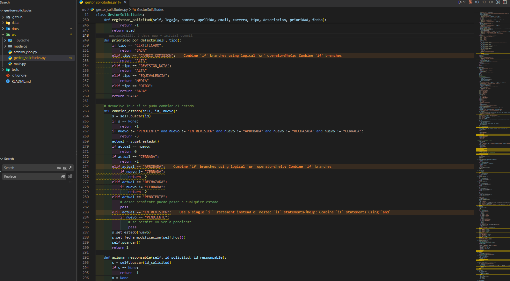
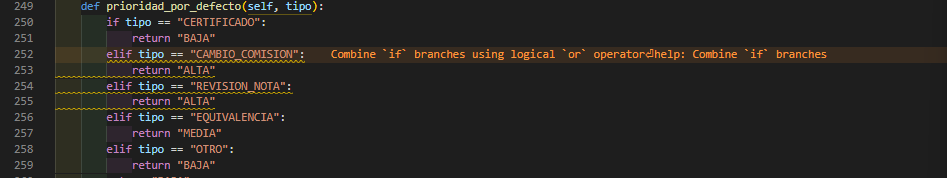
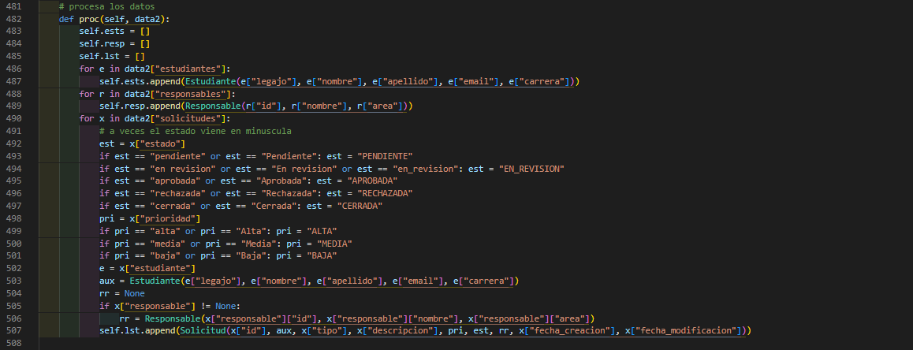
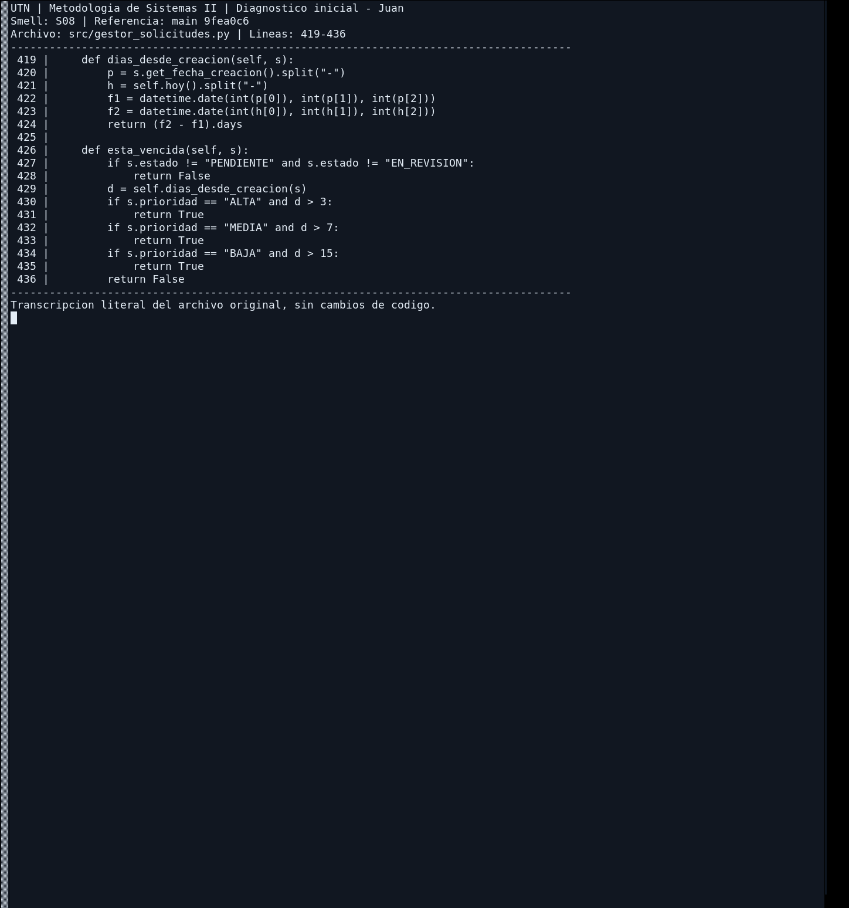
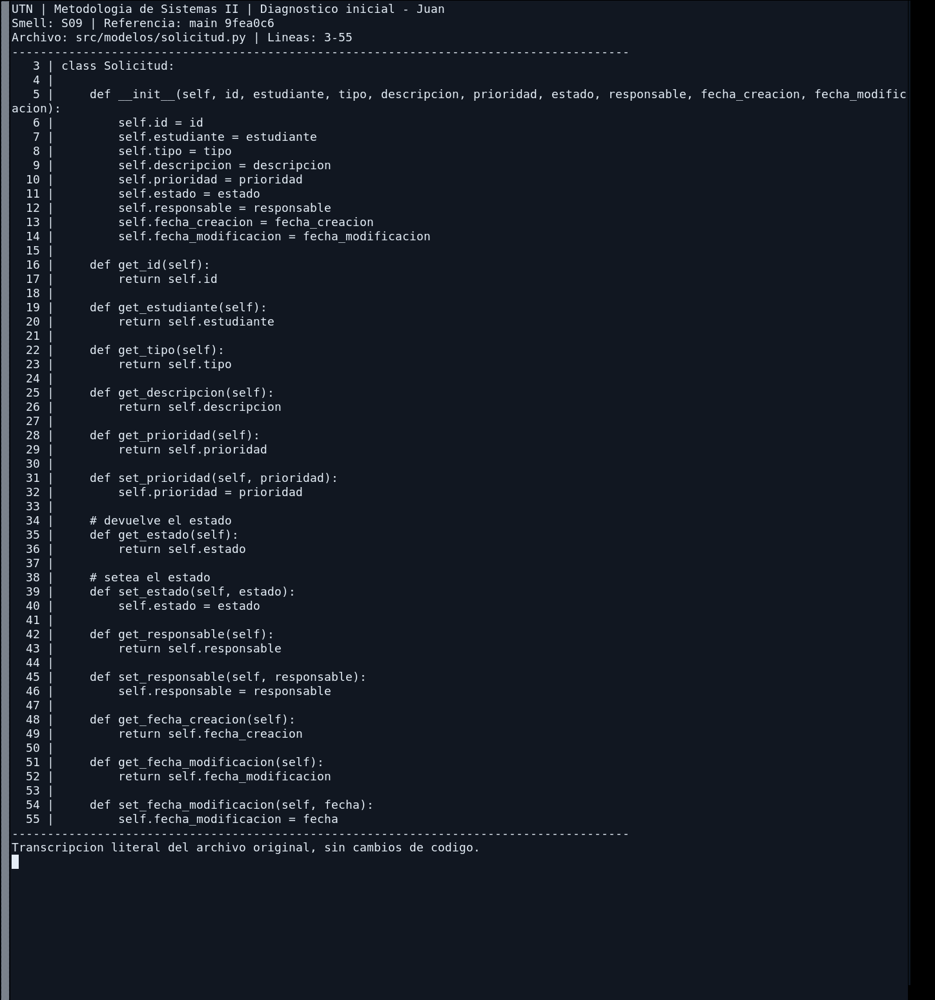
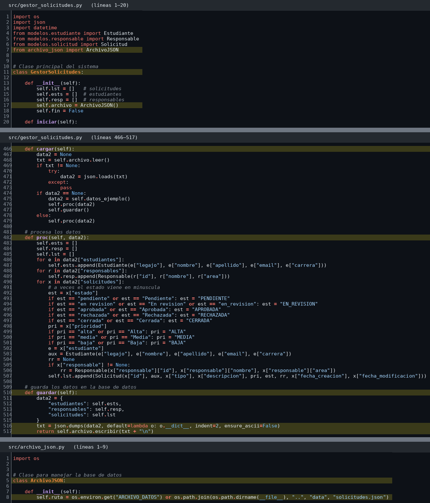
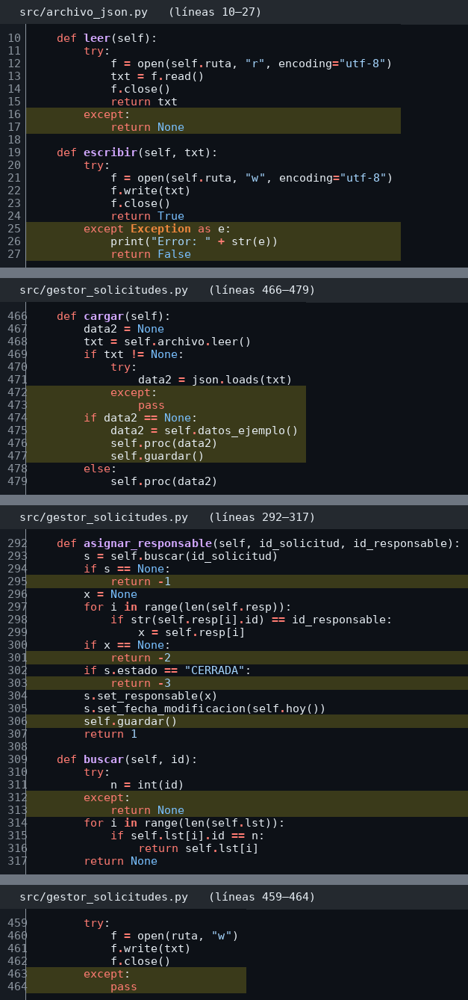
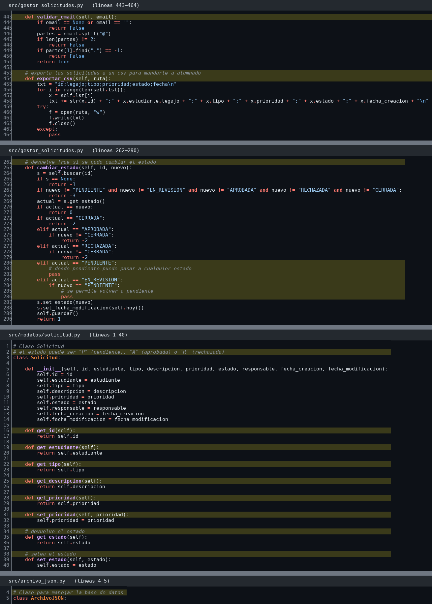

| ID | Smell | Evidencia | Ubicación | Impacto | Riesgo de mantenimiento | Prioridad | Principio violado | Refactoring propuesto | Autor |
| --- | --- | --- | --- | --- | --- | --- | --- | --- | --- |
| S01 | Long Method | `procesarOpcion()` tiene 80 líneas y mezcla lectura de datos, validación, guardado e impresión. Ver `codigo_gaston_S01.png` | `GestorSolicitudes.java` → `procesarOpcion()`, l. 40–120 | Difícil de leer y de entender; no se puede testear cada parte por separado | Cambiar una parte (por ejemplo, la validación) puede romper otra (el guardado o la impresión) | Alta | SRP; Clean Code: funciones cortas que hacen una sola cosa | Extract Method | Gaston |
| S02 | Long Parameter List | `registrarSolicitud(legajo, nombre, apellido, email, carrera, tipo, descripcion, prioridad, fecha)` recibe 9 parámetros. Ver `codigo_gaston_S02.png` | `GestorSolicitudes.java` → `registrarSolicitud(...)`, l. 130 | Fácil equivocarse en el orden de los parámetros; las llamadas son largas y poco claras | Agregar un dato nuevo obliga a cambiar la firma y todas las llamadas al método | Media | Clean Code: pocos parámetros por función | Introduce Parameter Object | Gaston |
| S03 | Malos nombres | Variables `x`, `lst`, `aux` y método `proc()` que no dicen qué contienen ni qué hacen. Ver `codigo_gaston_S03.png` | `GestorSolicitudes.java` → `proc()` l. 150; `lst` l. 45; `x` l. 62 | Hay que leer todo el código para entender qué representa cada nombre | Alto riesgo de confundir variables al modificar el código | Media | Clean Code: nombres que revelan intención | Rename | Gaston |
| S04 | If/else de transición de estados con códigos de retorno mágicos | `cambiar_estado()` encadena `if`/`elif` por cada estado actual y devuelve números sin significado propio (`-1`, `-2`, `-3`, `0`, `1`); `procesar_opcion()` repite el mismo mapeo para mostrar el mensaje correcto. Ver `codigo_gabriel_S04.png` | `src/gestor_solicitudes.py` → `cambiar_estado()` l. 263–290; `procesar_opcion()` l. 66–76 | Agregar un estado nuevo obliga a tocar dos lugares acoplados por un contrato implícito (los números de retorno) | Fácil olvidarse de actualizar uno de los dos, o reusar un código de error ya ocupado por otro caso | Alta | OCP; Clean Code: evitar "magic numbers" como códigos de error | Replace Conditional with Polymorphism (patrón State) + lanzar `TransicionInvalidaException` en vez de devolver códigos | Gabriel |
| S05 | Primitive Obsession: tipo y prioridad como strings sueltos | El menú de `registrar()` mapea cada opción numérica a un string de tipo escrito a mano; `prioridad_por_defecto()` repite esos mismos literales para derivar la prioridad por tipo. Ver `codigo_gabriel_S05.png` | `src/gestor_solicitudes.py` → `registrar()` l. 184–216; `prioridad_por_defecto()` l. 249–260 | Agregar un tipo de solicitud nuevo implica tocar el menú y dos bloques `if` por separado, en vez de un solo lugar | Nada impide escribir un string de tipo o prioridad mal tipeado; el error recién aparece en tiempo de ejecución | Alta | Clean Code: Primitive Obsession; OCP | Replace Magic String with Enum: crear `TipoSolicitud` y `Prioridad`, con la prioridad por defecto como propiedad del enum | Gabriel |
| S06 | Estados y prioridades con inconsistencias de mayúsculas, normalizadas a mano | Los datos de ejemplo ya traen variantes ("pendiente", "Alta", "media"); `proc()` las corrige con una cadena de `if` línea por línea que solo cubre las variantes previstas. Cualquier otra variante pasa sin normalizar. Ver `codigo_gabriel_S06.png` | `src/gestor_solicitudes.py` → `proc()` l. 490–501; `datos_ejemplo()` l. 535, 538, 542 | El resto del código compara contra el string exacto en mayúsculas (`s.estado == "PENDIENTE"`); una variante no prevista hace que una solicitud quede invisible para reportes o filtros sin ningún error visible | Bug silencioso, no lanza excepción, solo da resultados incorrectos | Alta | Clean Code: manejo de errores pobre / validación implícita; SRP | Reemplazar el string por un `Enum` con un parser único (`Estado.from_str()`) que normalice y lance una excepción clara si el valor no es válido | Gabriel |
| S07 | Duplicación de filtros | `filtrar_por_estado`, `filtrar_por_tipo`, `filtrar_por_prioridad` y `filtrar_por_legajo` repiten el recorrido y la selección de resultados. | `src/gestor_solicitudes.py:319–349` | Se repite la misma estructura de filtrado en cuatro métodos. | Cambiar el recorrido o añadir otro criterio obliga a revisar varios bloques y puede introducir diferencias. | Media | DRY; Clean Code; cohesión | Extraer una función común de filtrado y conservar las operaciones públicas | Juan |
| S08 | Feature Envy | `dias_desde_creacion(s)` y `esta_vencida(s)` calculan reglas a partir de atributos de `Solicitud`. | `src/gestor_solicitudes.py:419–436`; `src/modelos/solicitud.py` | El gestor conoce demasiados detalles de la solicitud, además de coordinar la interacción. | Cambiar el cálculo de antigüedad o vencimiento obliga a tocar el gestor. | Alta | SRP; cohesión; encapsulación | Move Method a `Solicitud`, con fecha de referencia explícita | Juan |
| S09 | Data Class / modelo anémico | `Solicitud` almacena datos y contiene getters/setters, mientras las reglas sobre vencimiento permanecen en el gestor. | `src/modelos/solicitud.py:3–55` y `src/gestor_solicitudes.py:419–436` | La entidad contiene poco comportamiento asociado a los datos que representa. | Al incorporar nuevas reglas, la lógica puede seguir acumulándose en el gestor. | Media | Cohesión; SRP | Incorporar únicamente comportamiento propio de `Solicitud`, sin incluir persistencia ni consola | Juan |
| S10 | God Class + acoplamiento directo a la persistencia | `GestorSolicitudes` tiene 544 líneas y 26 métodos: muestra el menú, lee la consola, valida, aplica las reglas de estado, filtra, arma el reporte, calcula vencimientos, convierte JSON ↔ objetos y guarda. Además crea su propio acceso a datos con `self.archivo = ArchivoJSON()`. Ver `codigo_fabri_S10.png` | `src/gestor_solicitudes.py` → clase `GestorSolicitudes`, l. 11–544; `__init__()` l. 17; `cargar()`, `proc()` y `guardar()` l. 466–517. `src/archivo_json.py` → `__init__()` l. 8 | Cualquier cambio (de menú, de regla o de formato del archivo) obliga a tocar la misma clase; no se puede probar la lógica sin leer y escribir el archivo real | Cambiar JSON por otra forma de guardar obliga a modificar el gestor; muchos conflictos de merge porque todos los integrantes tocan el mismo archivo | Alta | SRP; DIP (la lógica depende de una clase concreta de archivo, no de una abstracción) | Extract Class (`SolicitudRepositorioArchivo`) + Introduce Interface (`SolicitudRepositorio`) inyectada por constructor | Fabri |
| S11 | Manejo de errores pobre | `except:` vacíos que tragan el error (`return None`, `pass`); errores comunicados con códigos `-1`, `-2`, `-3`; la clase de archivo imprime por consola; el resultado de `guardar()` se ignora. Si el JSON está dañado, `cargar()` lo reemplaza por los datos de ejemplo y **pisa el archivo sin avisar** (probado). Si el archivo no se puede escribir, se muestra el error técnico (`[Errno 13] Permission denied`) y a continuación "Responsable asignado" (probado). Ver `codigo_fabri_S11.png` | `src/archivo_json.py` → `leer()` l. 16–17, `escribir()` l. 25–27. `src/gestor_solicitudes.py` → `cargar()` l. 472–477, `asignar_responsable()` l. 295–306, `cambiar_estado()` l. 266–289, `registrar_solicitud()` l. 245–246, `buscar()` l. 312–313, `exportar_csv()` l. 463–464 | Pérdida silenciosa de datos; el usuario ve un mensaje de éxito cuando la operación no se guardó; los códigos numéricos obligan a recordar qué significa cada valor | Cada error nuevo obliga a inventar otro código y a actualizar todos los `if r == ...` del menú; los fallos de archivo son difíciles de diagnosticar | Alta | Clean Code: manejo de errores (excepciones en vez de códigos de retorno, no ignorar errores, no mezclar la consola con el acceso a datos) | Excepciones propias (`SolicitudNoEncontradaException`, `ResponsableNoEncontradoException`, `PersistenciaException`) + eliminar los catch vacíos + mensajes consistentes al usuario | Fabri |
| S12 | Código muerto y comentarios desactualizados | `validar_email()` y `exportar_csv()` no se llaman desde ningún lado; 7 getters/setters de `Solicitud` sin uso (`get_id`, `get_estudiante`, `get_tipo`, `get_descripcion`, `get_prioridad`, `set_prioridad`, `get_fecha_modificacion`); ramas `elif ... pass` que no hacen nada. Comentarios falsos: estados "P/A/R" en `Solicitud`, "devuelve True" en un método que devuelve enteros, "base de datos" para un archivo JSON; comentarios que repiten el código (`# devuelve el estado`, `# setea el estado`). Ver `codigo_fabri_S12.png` | `src/gestor_solicitudes.py` → `validar_email()` l. 443–451, `exportar_csv()` l. 453–464, `cambiar_estado()` l. 262 y l. 280–286, comentario de `guardar()` l. 509. `src/modelos/solicitud.py` → l. 2, l. 16–32, l. 34, l. 38, l. 51. `src/archivo_json.py` → l. 4 | Confunde al lector: parece que el email se valida con `validar_email()`, pero `registrar()` solo busca una "@" (l. 180); parece que los estados son de una letra | Se mantiene código que nadie usa y los comentarios engañan a quien modifica; hay dos validaciones de email distintas que pueden divergir | Media | Clean Code: sin código muerto; comentarios que explican el "por qué", no el "qué", y que no mienten | Remove Dead Code + borrar o corregir los comentarios | Fabri |

### S01 - Long Method

### S02 - Long Parameter List

### S03 - Malos nombres

### S04 - If/else de transición de estados con códigos mágicos

### S05 - Primitive Obsession en tipo y prioridad

### S06 - Estados y prioridades normalizados a mano

### S07 - Duplicación de filtros (Juan)

### S08 - Feature Envy (Juan)

### S09 - Data Class (Juan)

### S10 - God Class y acoplamiento directo a la persistencia

### S11 - Manejo de errores pobre

### S12 - Código muerto y comentarios desactualizados

